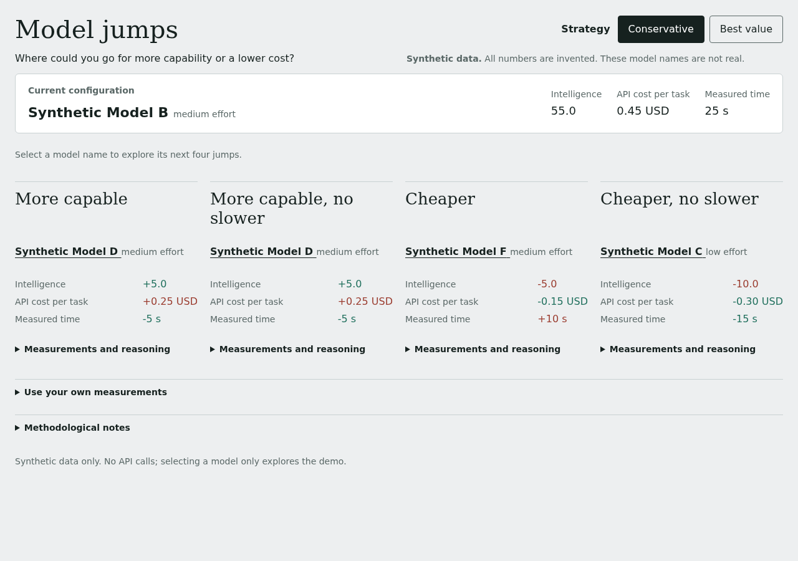

# Model Jumps Demo

Explore which model configuration to try next for more capability or lower cost.

> Live demo status: pending publication. No public URL has been verified.

The bundled example is synthetic: every number is invented, and selecting a result only explores the demo. It does not switch any real model.

## Try it

1. Choose your current configuration.
2. Compare the four directions under Conservative and Best value.
3. Select a target to explore its next four jumps, or open the own-data panel and paste your measurements.

Until publication, [run it locally from the project root](docs/using-the-demo.md#run-it-locally).

The directions are More capable, More capable, no slower, Cheaper, and Cheaper, no slower. Conservative limits what you give up. Best value gives direct improvements priority using the corresponding Conservative ordering, then applies its ratio rules. “No slower” never allows a longer measured time. Read the exact rules, input format, checks and limits in [Using the demo](docs/using-the-demo.md). Background: [Choosing a model from where you are](docs/choosing-a-model.md).

Your measurements stay in the browser tab, are never uploaded or stored, and disappear when you reload. Recommendations still need verification on your own task, scoring scale and measurement conditions.

The project is independent and is not affiliated with or endorsed by Artificial Analysis. MIT licence: see [LICENSE](LICENSE).

Copyright (c) 2026 Jaime Gonzalez Vallejo.
